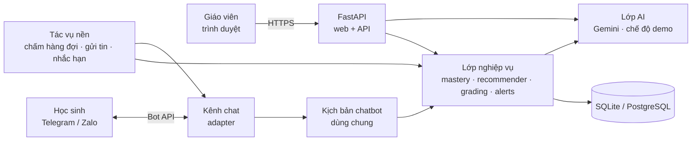

# Trợ lý ảo hỗ trợ giáo viên

[](https://render.com/deploy?repo=https://github.com/NguyenNhatThienQNU/tro-ly-ao-giao-vien)

Quản lý lớp học, cá nhân hóa bài tập và chấm bài qua ảnh bằng AI.

Giáo viên quản lý lớp trên web. Học sinh nhận đề và nộp ảnh bài làm qua chatbot (Telegram, Zalo). AI đề xuất bộ đề riêng theo điểm yếu của từng em và chấm sơ bộ bài viết tay theo rubric. Giáo viên là người duyệt và quyết định cuối cùng.

## Tính năng

| Bước | Chức năng | Ở đâu trong mã nguồn |
|---|---|---|
| 1 | Tạo lớp, nhập danh sách học sinh từ Excel/CSV, in phiếu QR. Học sinh quét QR là liên kết được với chatbot. | `app/web/classes.py`, `app/channels/bot_logic.py` |
| 2 | Tính mức nắm vững theo từng chủ đề của mỗi học sinh (mô hình Elo). Hệ thống đề xuất bộ đề riêng theo điểm yếu; câu thiếu thì AI soạn; giáo viên duyệt rồi mới gửi. | `app/services/mastery.py`, `recommender.py`, `assignments.py` |
| 3 | Học sinh chụp ảnh bài làm, gửi qua chatbot rồi gõ NOP để nộp. | `app/channels/` |
| 4 | AI đọc bài viết tay, chấm theo rubric, giải thích lỗi sai; giáo viên xác nhận hoặc sửa điểm, sau đó kết quả tự gửi cho học sinh. | `app/services/grading.py`, `app/ai/` |
| 5 | Dashboard: bản đồ nhiệt mức nắm vững, tiến độ nộp bài, cảnh báo học sinh tụt điểm, hổng kiến thức hoặc quá hạn. | `app/web/dashboard.py`, `app/services/alerts.py` |
| + | Trợ lý AI cho giáo viên: ra lệnh bằng tiếng Việt, ví dụ "Bạn Minh Anh là học sinh giỏi, tạo bộ đề nâng cao, hạn tối thứ 6" hoặc "Đây là bảng điểm của lớp… tạo bộ đề cho từng bạn, hạn 10h ngày mai". | `app/ai/assistant.py` |

Nguyên tắc thiết kế: AI chỉ đề xuất. Bộ đề và câu hỏi do AI tạo đều ở dạng nháp. Điểm AI chấm chỉ được tính vào mức nắm vững và gửi cho học sinh sau khi giáo viên xác nhận.

## Kiến trúc



Chi tiết thiết kế (CSDL, công thức, thuật toán, luồng xử lý) nằm trong [docs/thiet-ke-he-thong.md](docs/thiet-ke-he-thong.md).

## Cài đặt nhanh trên Windows

1. Cài Python 3.11 trở lên tại [python.org](https://www.python.org/downloads/). Khi cài, nhớ tích ô "Add python.exe to PATH".
2. Nhấp đúp tệp `run.bat` trong thư mục dự án. Lần đầu, script sẽ tạo môi trường ảo, cài thư viện, tạo tệp `.env` rồi khởi động máy chủ.
3. Mở trình duyệt vào http://localhost:8000. Tạo tài khoản giáo viên đầu tiên, rồi bấm "Nạp dữ liệu mẫu Tin học 10 (Python)" hoặc "Nạp dữ liệu mẫu Tin học 11 (CSDL & SQL)" để dùng thử ngay.

Chạy thủ công (Windows, macOS, Linux):

```bash
python -m venv .venv
.venv\Scripts\activate          # macOS/Linux: source .venv/bin/activate
pip install -r requirements.txt
copy .env.example .env          # macOS/Linux: cp .env.example .env
python -m app.cli seed-demo     # (tùy chọn) tài khoản demo@truonghoc.vn / demo1234 kèm dữ liệu mẫu
uvicorn app.main:create_app --factory --port 8000
```

Chỉ chạy một tiến trình (không dùng `--workers` lớn hơn 1), vì chatbot và tác vụ nền chạy chung trong tiến trình web.

## Cấu hình (tệp `.env`)

Khi chưa cấu hình gì, ứng dụng vẫn chạy ở chế độ demo: điểm AI là điểm mô phỏng, trợ lý chỉ hiểu một số câu lệnh mẫu. Ba kết nối chính:

### 1. AI: Google Gemini

- Lấy khóa tại https://aistudio.google.com/apikey, rồi điền `GEMINI_API_KEY=...`.
- `GEMINI_MODEL=gemini-flash-latest` là bí danh luôn trỏ tới bản Flash mới nhất. Có thể ghi tên mô hình cụ thể nếu muốn cố định phiên bản.
- Mã nguồn dùng thư viện `google-genai` (API `generateContent`), đầu ra JSON theo lược đồ, và gọi hàm (function calling) cho trợ lý.

### 2. Chatbot Telegram

1. Trên Telegram, nhắn `@BotFather`, gõ `/newbot`, đặt tên và nhận token.
2. Điền `TELEGRAM_BOT_TOKEN=...` và giữ `TELEGRAM_MODE=polling`. Chế độ này chạy được trên máy cá nhân, không cần tên miền.
3. Khởi động lại máy chủ, vào Lớp học, bấm "In phiếu QR liên kết", in ra và phát cho học sinh.

Khi triển khai trên máy chủ có HTTPS, có thể dùng `TELEGRAM_MODE=webhook` kèm `PUBLIC_BASE_URL=https://ten-mien` và `TELEGRAM_WEBHOOK_SECRET`.

### 3. Chatbot Zalo (thử nghiệm)

Tạo bot tại https://bot.zaloplatforms.com rồi điền `ZALO_BOT_TOKEN` và `ZALO_BOT_LINK`. Zalo Bot chưa có nút bấm, nên học sinh gõ lệnh (`NOP`, `HUY`, `BAITAP`, `KETQUA`, `TIENDO`). Phần này viết theo tài liệu công khai của Zalo Bot Platform và chưa thử với bot thật. Nên thử với vài học sinh trước khi dùng cho cả lớp.

## Quy trình sử dụng

1. Môn học, chủ đề và ngân hàng câu hỏi: mỗi câu có mức độ (Nhận biết, Thông hiểu, Vận dụng, Vận dụng cao), rubric chấm và đáp án tham khảo. Có thể nhờ AI soạn câu nháp rồi duyệt.
2. Lớp học: nhập danh sách từ Excel (cột "Họ và tên", "Mã HS"), nhập bảng điểm có sẵn (cột "Điểm" hoặc cột trùng tên chủ đề) để hệ thống có dữ liệu ban đầu, rồi in phiếu QR.
3. Giao bài: chọn chế độ (Cá nhân hóa, Nâng cao, Ôn tập), số câu và hạn nộp. Hệ thống tạo bộ đề nháp cho từng em, kèm giải thích lý do chọn câu. Giáo viên chỉnh sửa rồi bấm "Duyệt & gửi". Học sinh nhận đề qua chatbot.
4. Chấm bài: học sinh gửi ảnh và gõ NOP. AI chấm sơ bộ (chép lại bài làm, điểm từng tiêu chí, lỗi sai và cách sửa, độ tin cậy). Bài có độ tin cậy thấp được đánh dấu "cần xem kỹ". Giáo viên xác nhận hoặc sửa điểm, kết quả tự gửi cho học sinh. Nếu ảnh mờ, giáo viên có thể trả bài để học sinh nộp lại.
5. Theo dõi: trang Tổng quan và hồ sơ từng học sinh. Hệ thống tự nhắc hạn trước 12 giờ (chỉnh được).

Lệnh chatbot dành cho học sinh: gửi ảnh để nộp bài, `NOP`, `HUY`, `BAITAP`, `KETQUA`, `TIENDO`, `HUONGDAN`.

## Lệnh quản trị

```bash
python -m app.cli init-db                                   # tạo/cập nhật CSDL (Alembic)
python -m app.cli create-teacher --name "Nguyễn Văn A" --email a@truong.edu.vn --password matkhau
python -m app.cli reset-password --email a@truong.edu.vn --password matkhaumoi
python -m app.cli seed-demo                                  # tài khoản + dữ liệu mẫu
alembic revision --autogenerate -m "mo ta"                   # sau khi sửa app/models.py
```

Tài liệu API tự sinh: http://localhost:8000/api/docs

## Triển khai bằng Docker

```bash
cp .env.example .env    # điền khóa
docker compose up -d --build
```

Dữ liệu (CSDL và ảnh bài làm) được lưu ở thư mục `./data` gắn vào container. Khi đưa lên Internet, đặt sau reverse proxy có HTTPS (Caddy hoặc Nginx).

## Kiểm thử

```bash
pip install -r requirements-dev.txt
pytest          # 45 bài kiểm thử: mô hình, giao bài, chấm bài, chatbot, tác vụ nền, trợ lý, web, migration
ruff check .    # kiểm tra chuẩn mã
```

Bộ kiểm thử không cần Internet. Gemini, Telegram và Zalo đều được giả lập (chế độ demo, `httpx.MockTransport`).

## Cấu trúc thư mục

```
app/
  main.py            khởi tạo ứng dụng, vòng đời (bật chatbot + tác vụ nền)
  config.py          cấu hình từ .env
  models.py          mô hình dữ liệu (SQLAlchemy 2)
  services/          nghiệp vụ: mastery, recommender, assignments, grading, alerts, importer, messages, qr, storage, students
  ai/                lớp AI: base (giao diện), gemini, mock (demo), prompts, assistant (trợ lý gọi công cụ), schemas
  channels/          chatbot: bot_logic (kịch bản dùng chung), telegram, zalo, base (adapter + hub)
  worker.py          tác vụ nền: chấm hàng đợi, gửi đề/kết quả, nhắc hạn
  web/               route giao diện giáo viên + webhook + trang xem đề công khai
  templates/, static/  giao diện (Bootstrap 5, thư viện đóng gói sẵn trong static/vendor – chạy được không cần Internet)
  seed.py, cli.py    dữ liệu mẫu, lệnh quản trị
migrations/          Alembic
tests/               pytest
docs/                tài liệu thiết kế, tệp mẫu nhập liệu
```

## Bảo mật và dữ liệu cá nhân

- Mật khẩu băm bằng scrypt. Phiên đăng nhập ký bằng khóa bí mật. Mọi form có mã CSRF. Mỗi giáo viên chỉ thấy dữ liệu lớp của mình.
- Mã liên kết chatbot dùng một lần cho một tài khoản chat; có nút "Cấp lại mã" khi học sinh đổi tài khoản.
- Khi chấm bài, hệ thống chỉ gửi ảnh và đề bài cho AI, không gửi họ tên học sinh. Trợ lý của giáo viên có xử lý tên học sinh để tra cứu.
- Học sinh phần lớn chưa đủ 18 tuổi. Trước khi dùng thật cần thông báo và xin đồng ý của phụ huynh theo quy định về bảo vệ dữ liệu cá nhân. Theo điều khoản của Google, dữ liệu gửi qua gói Gemini miễn phí có thể được dùng để cải thiện sản phẩm. Với dữ liệu thật nên dùng gói trả phí (hoặc Vertex AI), hoặc ẩn danh hóa.
- Ảnh bài làm lưu ở `data/uploads`. Cần sao lưu thư mục `data/` định kỳ.

## Giới hạn hiện tại và hướng phát triển

- Độ chính xác khi đọc chữ viết tay phụ thuộc chất lượng ảnh và mô hình AI. Hệ thống đã có bước giáo viên xác nhận và đánh dấu các bài có độ tin cậy thấp.
- Tham số mô hình Elo (K, độ khó theo mức) đang đặt sẵn. Có thể hiệu chỉnh từ dữ liệu thực nghiệm.
- Hướng mở rộng: nộp bài qua web cho học sinh không dùng Telegram/Zalo, đăng nhập Google, xuất báo cáo Excel, nhà cung cấp AI khác (thêm một lớp trong `app/ai/`).
